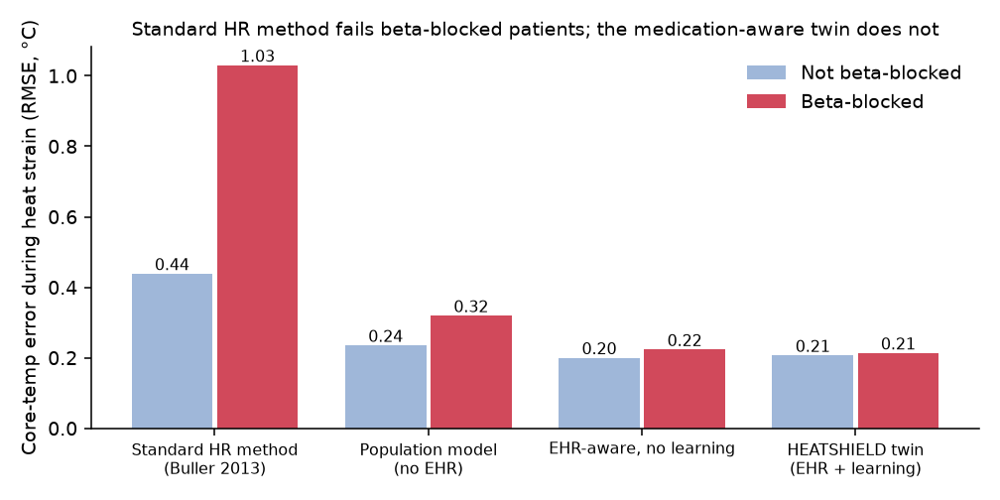
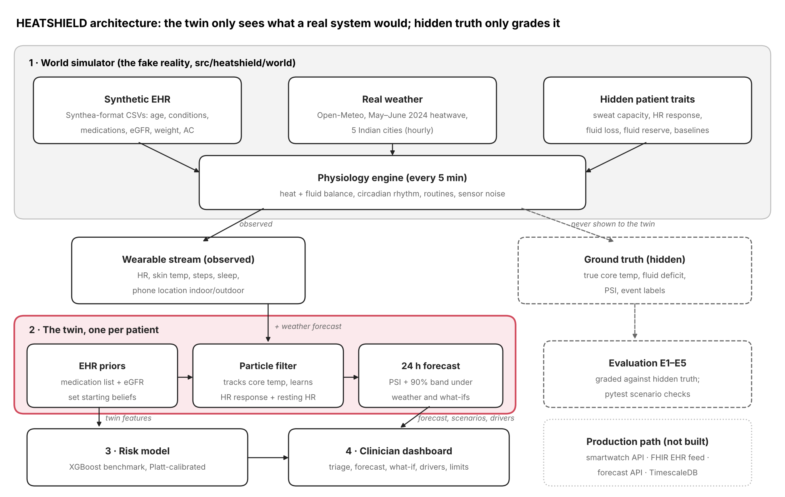
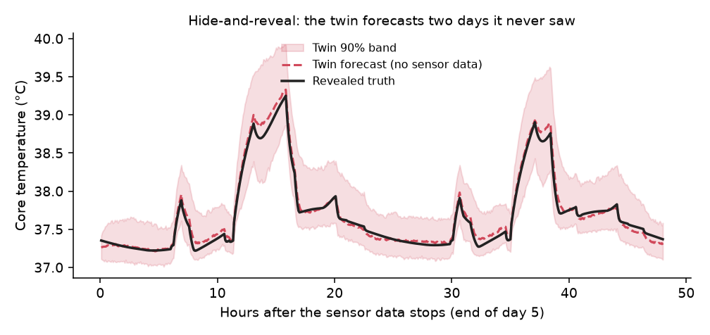
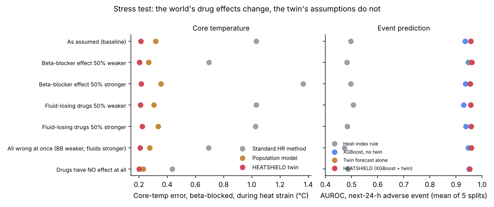
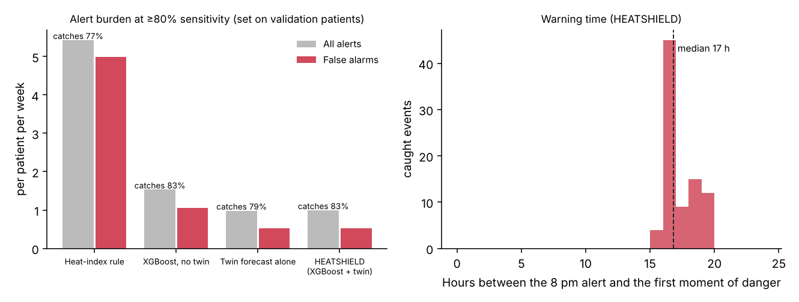

# HEATSHIELD: a medication-aware digital twin for heat strain in vulnerable patients

> **Happiest Health Digital Twin Challenge 2026** · Prototype on synthetic data · **Not validated for clinical use**

**▶ Live demo:** https://amishasharma2220-heatshield-manipaluniversi-appdashboard-il5ao4.streamlit.app/  ·  **🎬 Video:** PASTE_YOUTUBE_LINK_HERE

**In one line:** smartwatches estimate body heat from heart rate, which fails for the many older Indians on beta-blockers. HEATSHIELD builds a digital twin of each patient from their medical record and watch data, forecasts dangerous heat strain 24 hours ahead, and lets the doctor test what-ifs.

| Headline result (240 synthetic patients, real May–June 2024 heatwave weather) | |
| --- | --- |
| Core-temperature error in beta-blocked patients during heat strain | **1.03 °C → 0.21 °C** (standard method → twin) |
| …when the simulator's drug effects are made 50% weaker, 50% stronger, or removed entirely | twin stays at **0.20–0.22 °C** |
| …when half of the watch data is missing (charging, nights off-wrist, motion spikes) | twin stays at **0.22 °C** |
| Next-24-h adverse event, AUROC | heat-index rule 0.50 · XGBoost 0.94 · **twin 0.96** (no labelled data needed) |
| Alerts per patient per week at ~80% of events caught | heat-index rule 5.4 · XGBoost 1.5 · **twin 1.0** (half the false alarms of XGBoost) |
| Warning time | alert at 8 pm the evening before, **median 17 h before the danger** |



## Team

| | |
| --- | --- |
| Team name | HEATSHIELD |
| Members | Amisha Sharma (team leader), Meet Siroya |
| College / incubator | Manipal University Jaipur |
| Contact | amishasharma2220@gmail.com |

## Project title

**HEATSHIELD: a patient-specific, medication-aware digital twin that forecasts heat strain 24 hours ahead and lets a clinician test what-if scenarios.**

## Problem statement and healthcare use case

Indian heatwaves routinely push daytime temperatures into the mid-40s °C. Older patients with hypertension, type 2 diabetes or chronic kidney disease are the most vulnerable, and several of their everyday medicines make heat more dangerous:

| Drug class | Effect in heat |
| --- | --- |
| Diuretics (hydrochlorothiazide, chlorthalidone) | Extra fluid loss: the patient dehydrates faster |
| SGLT2 inhibitors (dapagliflozin, empagliflozin) | Glucose in urine pulls water with it |
| Beta-blockers (metoprolol, atenolol) | Blunt the heart-rate rise, hiding the usual warning sign |

Wearables cannot measure core body temperature, so heat-strain monitors estimate it from heart rate. **That assumption breaks for beta-blocked patients**: core temperature rises but heart rate doesn't follow, so the standard method underestimates strain in exactly the people most at risk.

**Use case.** A clinician or care team monitoring vulnerable patients during a heatwave. Each evening HEATSHIELD ranks patients by tomorrow's risk. For any patient, the doctor sees the twin's estimate of their current state, a 24-hour strain forecast with uncertainty, the main drivers, and can test scenarios: *stay indoors 11am–4pm*, *hotter day*, *power cut*, *lighter activity*, *extra fluids*, or a clearly labelled *hypothetical* medication scenario.

**Adverse event predicted.** High heat strain in the next 24 hours, defined as Physiological Strain Index (PSI, Moran et al. 1998) ≥ 7 **or** core temperature ≥ 39.0 °C. The temperature arm stops a drug-blunted heart rate from hiding real strain.

### What makes it a digital twin, not a classifier

| | Typical ML model | HEATSHIELD |
| --- | --- | --- |
| Learns | Population patterns | This patient's own heat response |
| Output | A risk score now | A forecast trajectory with an uncertainty band |
| Updates | Retrained occasionally | Every 5 minutes, with each wearable reading |
| Answers "what if?" | No | Yes: re-simulates the patient under changed inputs |
| Needs labelled outcomes | Yes | No: the forecast is mechanistic |

## Architecture



1. **World simulator** (`src/heatshield/world/`): the "fake reality". A rich heat + fluid balance generates each patient's wearable stream and hidden ground truth. It has per-patient hidden traits (sweat capacity, heart-rate response to heat, fluid-loss rate, fluid reserve, resting HR and core temperature), a circadian rhythm, humidity-limited sweating, solar load, sensor noise and dropouts. **The twin never sees any of this**: it is used only to grade the twin.
2. **The twin** (`src/heatshield/twin/`): one virtual patient per person.
   - *EHR priors:* age, eGFR, weight and the medication list set starting beliefs (e.g. beta-blocker → low heart-rate response; diuretic/SGLT2i → extra fluid loss; low eGFR → smaller fluid reserve).
   - *Particle filter:* 400 particles per patient track core temperature and fluid deficit from heart rate, skin temperature, activity, phone location (indoor/outdoor) and weather, and learn the patient's heart-rate response and resting HR online (Liu–West parameter learning). The twin's own physics is deliberately **simpler** than the world's, so it cannot read its own answers back.
   - *Forecast:* every particle is run 24 h forward under the weather forecast and the patient's usual routine, giving a PSI curve, a 90% band and P(high strain).
   - *Scenarios and explanations:* inputs are changed and the forecast re-run; drivers are ranked by how much risk drops when each is reset.
3. **Risk model** (`src/heatshield/risk/`): XGBoost on EHR + wearable + weather (+ twin) features, patient-level split, Platt calibration. Used as a benchmark and second opinion.
4. **Clinician dashboard** (`app/dashboard.py`): Streamlit + Plotly. Triage list; per-patient tabs for overview, live twin state, 24 h forecast with drivers, what-if simulator (one patient × two scenarios, or two patients × the same heatwave), **live replay** (the next day unfolds hour by hour, the twin re-forecasts as watch data arrives and shows when the alert fires), **family alert & FHIR export**, and evidence & limits. A second view, **District health officer**, aggregates tomorrow's high-risk patients by city (with how many lack AC) for heat-action-plan outreach.
5. **Outputs** (`src/heatshield/advisory.py`, `src/heatshield/fhir.py`):
   - *Family alert draft* in Hindi and English, with the high-risk window and practical steps. The doctor edits and approves it; it never suggests changing a medicine, and it defers fluid amounts to the doctor because some patients are on a fluid limit.
   - *FHIR R4 export*: the forecast as a `RiskAssessment` and the estimated core temperature as an `Observation` (LOINC 8310-5), bundled with the `Patient`. FHIR R4 is the standard behind India's ABDM health-record exchange, so the output can flow into hospital systems without custom integration.

Production path (not built): smartwatch APIs for the wearable stream, a FHIR feed *into* the twin for the EHR, a live weather-forecast API, a time-series database (PostgreSQL/TimescaleDB) for twin states, SMS/WhatsApp gateway for approved alerts.

## Data (all synthetic or open; no real patient data)

| Stream | Source in this repo | Notes |
| --- | --- | --- |
| EHR | `heatshield.ehr` writes **Synthea-format** CSVs (`patients`, `conditions`, `medications`, `observations`) for 240 adults aged 55–85 | Real Synthea output can be dropped into `data/raw/ehr/` instead; the same loader maps it. India-specific fields added: home AC, outdoor routine |
| Weather | `heatshield.weather`: Open-Meteo historical archive, May–June 2024 heatwave, 5 cities (Jaipur, Delhi, Jodhpur, Nagpur, Lucknow) | `python -m heatshield.weather --fetch` downloads real data. The repo ships the real downloaded data; if a fetch is impossible, a labelled synthetic heatwave is generated instead, and `data/raw/weather/SOURCE.txt` records which |
| Wearable | Generated by the world simulator every 5 min: heart rate, skin temperature, steps, sleep, indoor/outdoor | Sensor noise and 2% dropouts; E6 adds up to 47% missing data and motion spikes |

Every physiological and drug assumption is in **one file**: [`config/assumptions.yaml`](config/assumptions.yaml). All effect sizes are illustrative, not clinical reference values.

## Technical stack and AI/ML details

| Layer | Tools |
| --- | --- |
| Language | Python 3.11+ |
| State estimation | NumPy particle filter (vectorised over patients × particles), Liu–West parameter learning; Buller et al. (2013) extended Kalman filter as baseline |
| Physiology | Heat balance (metabolic, dry exchange, humidity-limited sweating, regulation) + fluid balance |
| Risk model | XGBoost, scikit-learn (Platt calibration, metrics) |
| Dashboard | Streamlit, Plotly |
| Interoperability | HL7 FHIR R4 (RiskAssessment, Observation, Patient) |
| Tests | pytest (12 checks: scenario behaviour, FHIR structure, message safety, live replay) |

## Results (240 synthetic patients, real May–June 2024 heatwave weather)

E1–E3 use every patient, because the twin is never trained on outcomes. E4 and E7 report test patients from patient-level splits, since XGBoost is trained on labels.

**E1 · Medication-awareness matters.** Core-temperature error during heat strain (true core ≥ 37.8 °C):

| Method | Beta-blocked | Not beta-blocked |
| --- | --- | --- |
| Standard HR method (Buller 2013) | 1.03 °C | 0.44 °C |
| Population model (no EHR) | 0.32 °C | 0.24 °C |
| EHR-aware, no learning | 0.22 °C | 0.20 °C |
| HEATSHIELD twin | **0.21 °C** | **0.21 °C** |

The standard method underestimates beta-blocked patients' core temperature by about 1.0 °C on average during heat strain (mean bias −0.99 °C). See `results/e1_example_trace.png`.

**E2 · The twin learns the patient.** Error in the patient's heart-rate response to heat falls from 10.5 bpm/°C (population average) to 3.0 (EHR prior) to 2.5 after the wearable data (correlation with the hidden truth 0.97); resting-HR error falls from 2.0 to 0.6 bpm.
*Limitation:* sweat capacity and fluid-loss rate are **not identifiable** from wrist heart rate and skin temperature; learning them made estimates worse. They stay at EHR-based estimates and their uncertainty is carried into every forecast.

**E3 · Hide-and-reveal.** Calibrate on days 1–5, forecast days 6–7 with no sensor data, then reveal the truth. For the hidden days the twin is given the actual weather and logged activity, so E3 tests its physiology and learned traits; E4 is the true forecast test, using the weather forecast and the patient's usual routine.

| Model | Core-temp RMSE | Peak-PSI error | 90% band coverage |
| --- | --- | --- | --- |
| Population model | 0.16 °C | 0.90 | 77% |
| EHR-aware, no learning | 0.14 °C | 0.39 | 83% |
| **HEATSHIELD twin** | **0.14 °C** | **0.29** | **82%** |



**E4 · Predicting tomorrow's high strain** (1,680 patient-evenings, 7.6% events; mean over 5 random patient splits):

| Model | AUROC | AUPRC | Brier |
| --- | --- | --- | --- |
| Heat-index rule | 0.50 | 0.10 | 0.59 |
| XGBoost, no twin | 0.94 | 0.52 | 0.05 |
| **Twin forecast alone** | **0.96** | **0.59** | 0.06 |
| XGBoost + twin features | **0.96** | 0.58 | **0.05** |

A one-size-fits-all heat-index rule does no better than chance at picking out which patients will be strained. The twin's mechanistic forecast matches or slightly beats a supervised model trained on 1,000+ labelled patient-days (AUROC 0.96 vs 0.94, a gap of about one standard deviation across the 5 splits), **without needing any labelled outcomes**, which a real clinic would not have. That is why the dashboard's primary risk is the twin's own forecast.

**E5 · Stress test: what if our drug assumptions are wrong?** A fair objection is that the simulator *builds in* the beta-blocker effect, so the twin is bound to win. So we changed the world's drug effects while the twin kept its original assumptions (`experiments/robustness.py`):

| World's true drug effect | Core-temp error, beta-blocked: standard method | Population model | EHR-aware, no learning | **HEATSHIELD twin** | Event AUROC: XGBoost / **twin** |
| --- | --- | --- | --- | --- | --- |
| As assumed | 1.03 °C | 0.32 | 0.22 | **0.21** | 0.94 / **0.96** |
| Beta-blocker effect 50% weaker | 0.70 | 0.27 | 0.20 | **0.20** | 0.95 / **0.96** |
| Beta-blocker effect 50% stronger | 1.36 | 0.36 | 0.28 | **0.22** | 0.94 / **0.96** |
| Fluid-losing drugs 50% weaker | 1.03 | 0.31 | 0.22 | **0.21** | 0.93 / **0.96** |
| Fluid-losing drugs 50% stronger | 1.03 | 0.34 | 0.24 | **0.22** | 0.94 / **0.96** |
| All wrong at once | 0.69 | 0.28 | 0.20 | **0.21** | 0.95 / **0.96** |
| Drugs have **no** effect at all | 0.44 | 0.23 | 0.23 | **0.20** | 0.95 / **0.95** |

The twin's error stays between 0.20 and 0.22 °C in every world, because it **learns** each patient's heart-rate response from the watch and corrects a wrong prior. The model without learning degrades when the assumption is wrong (0.28 °C when the beta-blocker effect is stronger). *Limitation:* when drugs have no effect at all, the twin's advantage over XGBoost disappears (0.95 vs 0.95) and its 90% band coverage drops from 82% to 78%: the medication-awareness only pays off if the drug effect is real.



**E6 · Messy wearable data.** Real watches are taken off to charge, left on the table at night and produce motion spikes. We removed up to 47% of the wrist data the twin sees (a daily charging gap, 25–50% of nights off-wrist, 10–25% random dropouts, 3–8% spikes of ±15–35 bpm):

| Wrist data | Missing | Standard method error (β-blocked) | Twin error (β-blocked) | Twin 90% band coverage | Event AUROC (twin) |
| --- | --- | --- | --- | --- | --- |
| Clean | 2% | 1.03 °C | 0.21 °C | 82% | 0.96 |
| Realistic | 24% | 1.05 °C | 0.22 °C | 82% | 0.96 |
| Poor | 47% | 1.08 °C | 0.22 °C | 82% | 0.96 |

*Interpretation:* the twin barely notices, because its core-temperature estimate is driven mainly by its physiology model with weather, activity level and indoor/outdoor location; the wrist data mainly teaches it the patient's personal heart-rate response. The uncertainty band therefore does not widen with missing data. If activity and location were also missing, performance would fall; we did not test that.

**E7 · Alert burden and warning time.** A useful alert system must not flood the doctor. For each model the alert threshold was chosen on validation patients to catch at least 80% of events; results on test patients, mean of 5 splits:

| Model | Events caught | Alerts per patient per week | False alarms per patient per week | Alerts that were right (PPV) |
| --- | --- | --- | --- | --- |
| Heat-index rule | 77% | 5.4 | 5.0 | 8% |
| XGBoost, no twin | 83% | 1.5 | 1.1 | 33% |
| Twin forecast alone | 79% | 1.0 | 0.5 | 48% |
| **HEATSHIELD (XGBoost + twin)** | **83%** | **1.0** | **0.5** | **48%** |

At the same sensitivity the twin halves XGBoost's false alarms and cuts the heat-index rule's by about 10×. Alerts go out at 8 pm; the danger begins a **median 17 h later** (10th percentile 16 h), so there is a full morning to act. The warning time is set mainly by the 8 pm alert time and is about the same for every model; the twin's gain is in false alarms. The dashboard's *Live replay* tab shows this for one patient hour by hour.



**Scenario checks** (`tests/`, 12 checks, all pass): a hotter day never lowers strain; staying indoors, lighter activity and extra fluids never raise it; a power cut only matters for patients with AC; the diuretic scenario only changes diuretic patients; PSI formula endpoints; FHIR export structure; the family message always includes the emergency number and never tells anyone to stop a medicine; live replay consistency.

## How to run

```bash
pip install -r requirements.txt           # Mac only, first time: brew install libomp  (XGBoost needs it)
python -m heatshield.weather --fetch      # optional: real Open-Meteo weather (needs internet; run from src/ or set PYTHONPATH=src)
python experiments/run_all.py              # data -> world -> twin -> E1-E4 -> results/  (~3 min)
python experiments/robustness.py           # E5 stress test, E6 messy data, E7 alerts (~25 min; results already in results/)
pytest -q                                  # 12 checks
streamlit run app/dashboard.py             # clinician dashboard
```

`python experiments/run_all.py --quick` runs a 60-patient smoke test in under a minute.

## Repository layout

```
config/assumptions.yaml     every modelling assumption in one place
src/heatshield/
  ehr.py                    Synthea-format EHR generator + loader
  weather.py                Open-Meteo download, synthetic fallback, indoor model, heat index
  schedule.py               daily routines (activity, location, drinking)
  psi.py                    Physiological Strain Index
  world/simulate.py         world simulator (ground truth, hidden from the twin)
  twin/model.py             the twin's simplified physics + EHR priors
  twin/filter.py            particle filter, Buller baseline, forecasting
  twin/scenarios.py         what-if scenarios
  twin/twin.py              PatientTwin class used by the dashboard (incl. live replay)
  risk/features.py, train.py
  advisory.py               family alert drafts (Hindi / English)
  fhir.py                   FHIR R4 export
experiments/run_all.py      reproduces E1-E4
experiments/robustness.py   reproduces E5-E7
tests/                      scenario, FHIR, message-safety and replay checks
app/dashboard.py            Streamlit app
results/                    metrics (CSV) and figures (PNG)
docs/                       architecture diagram and presentation
```

## Demo video

**Video (≥ 20 minutes):** PASTE_YOUTUBE_LINK_HERE

**Live dashboard:** https://amishasharma2220-heatshield-manipaluniversi-appdashboard-il5ao4.streamlit.app/ (first visit to a fresh deployment builds the data, about 5 minutes)

## Documents

- Architecture diagram: [`docs/architecture.pdf`](docs/architecture.pdf)
- Presentation: [`docs/presentation.pdf`](docs/presentation.pdf)

## Limitations and responsible use

- All data is synthetic. The results show the method works in a simulated world under stated assumptions, not clinical accuracy.
- The physiology is simplified; drug effect sizes are illustrative.
- The stress test (E5) varies drug effect sizes, but the twin's model structure still matches the simulator's in kind (heat + fluid balance); a real body can differ in ways neither model has.
- The twin is given the simulator's logged activity level and indoor/outdoor timing. A real system would estimate these from phone steps and location, with error, so results are a best case for those inputs.
- The messy-data test (E6) assumes activity and indoor/outdoor location are still known when the watch is off.
- Warning times (E7) come from an 8 pm forecast for the next day; same-day alerts are shown in the live replay but not evaluated.
- PSI was designed for exertional heat strain in healthy people; it is used here as a research target, not a diagnosis.
- Medication scenarios show **attributable risk only**. HEATSHIELD never recommends stopping or changing a medicine.
- Real deployment needs validation on real wearable and EHR data, with ethics approval and DPDP-compliant data handling.

## Related work

Personal heat-strain digital twins exist for **healthy** workers, soldiers and athletes (e.g. NTU Singapore's construction-worker twin, the ThermRisk project). A systematic review of 25 wearable core-temperature algorithms found few used individual health data. HEATSHIELD's contribution is making the twin **patient-specific through the EHR**, and in particular correcting for beta-blockers, which break the standard heart-rate method.

**Key references:** Moran, Shitzer & Pandolf (1998) *Am J Physiol* 275:R129 (PSI); Buller et al. (2013) *Physiol Meas* 34:781 (core temperature from heart rate; coefficients also in US patent US20140180027A1); Liu & West (2001) in *Sequential Monte Carlo Methods in Practice* (parameter learning); Dolson et al. (2022) *Sensors* 22:7639 (systematic review of 25 algorithms from 20 studies); HL7 FHIR R4 RiskAssessment resource.

## License

[MIT](LICENSE)
